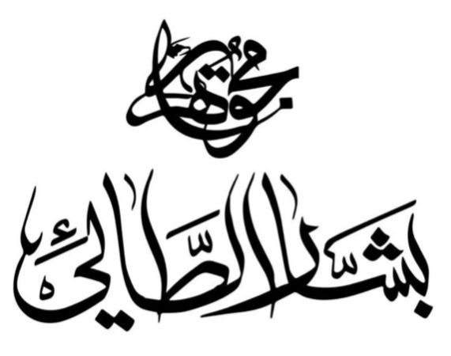
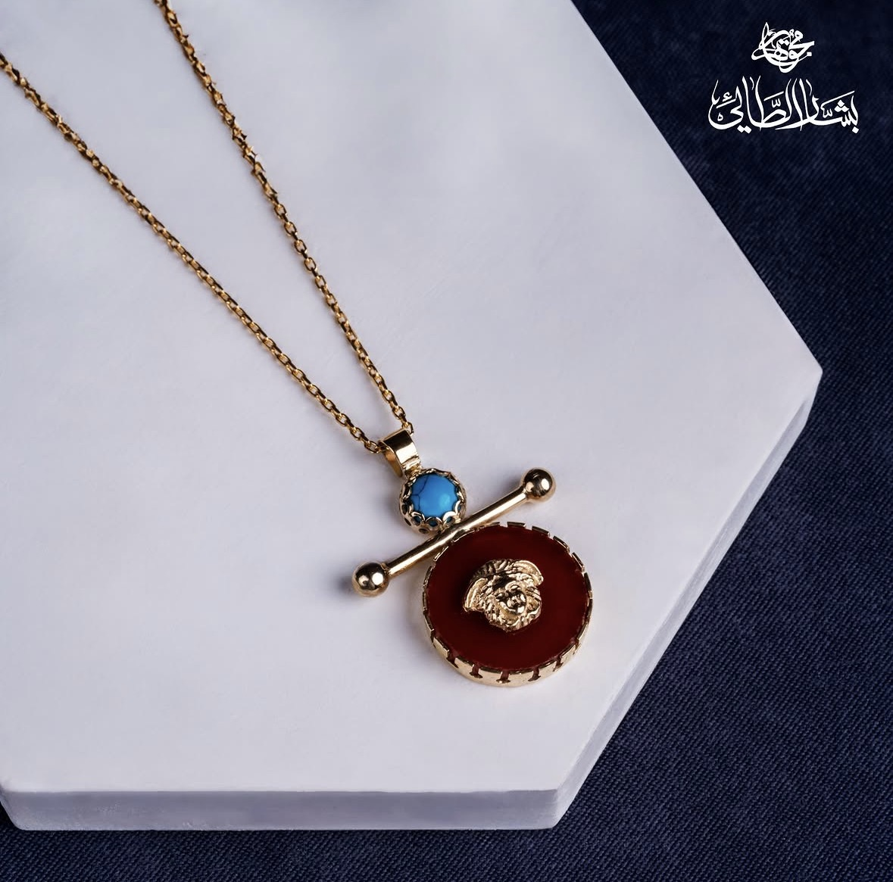
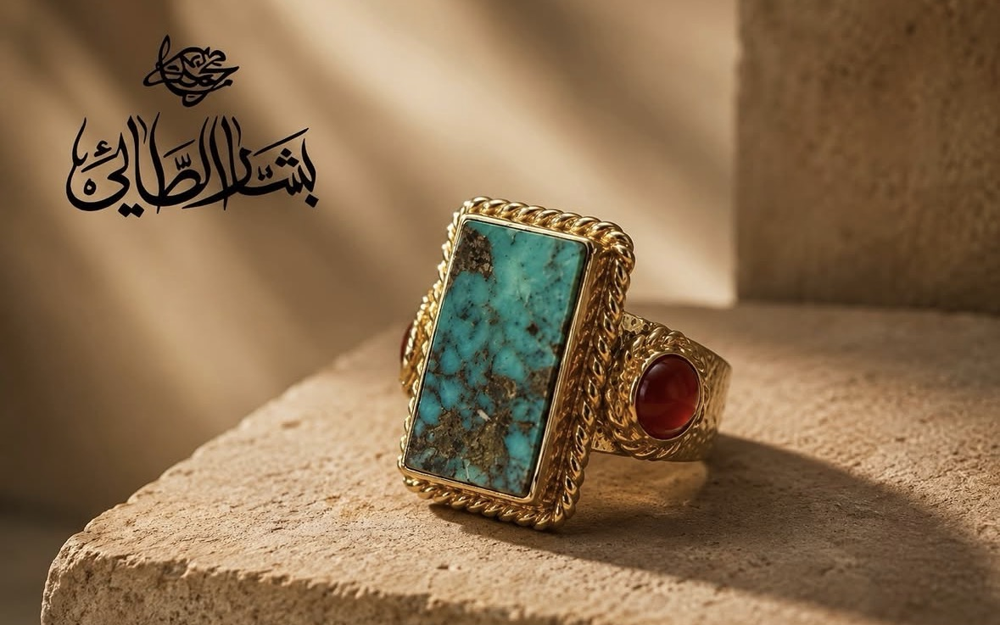
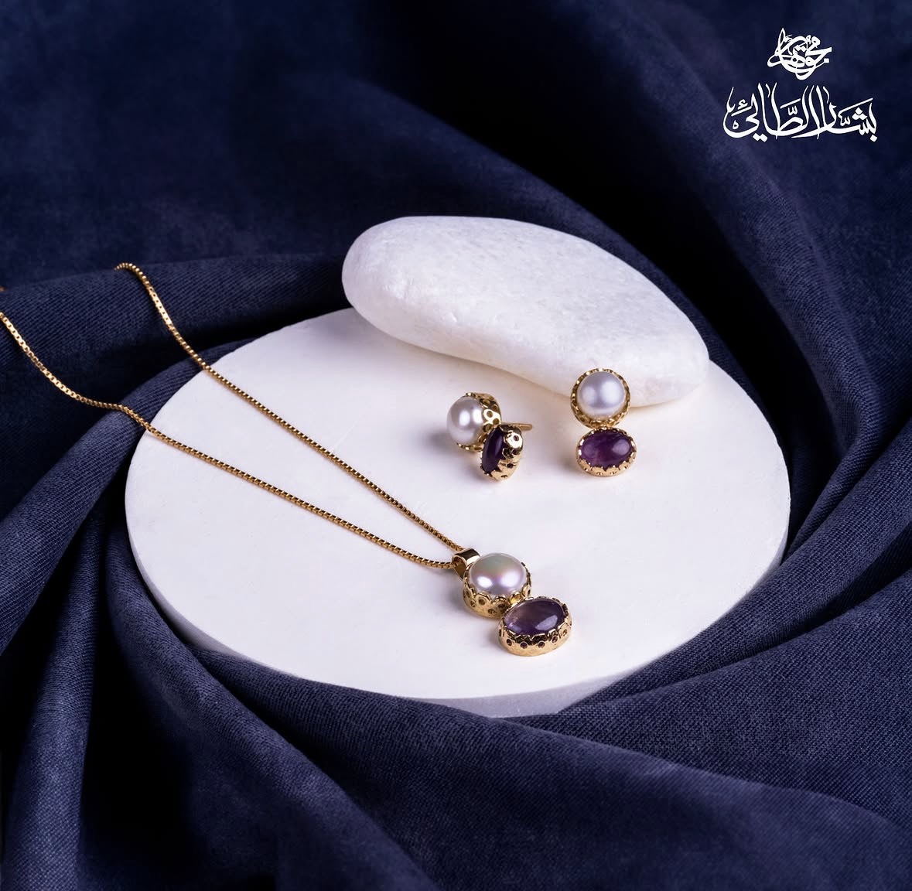
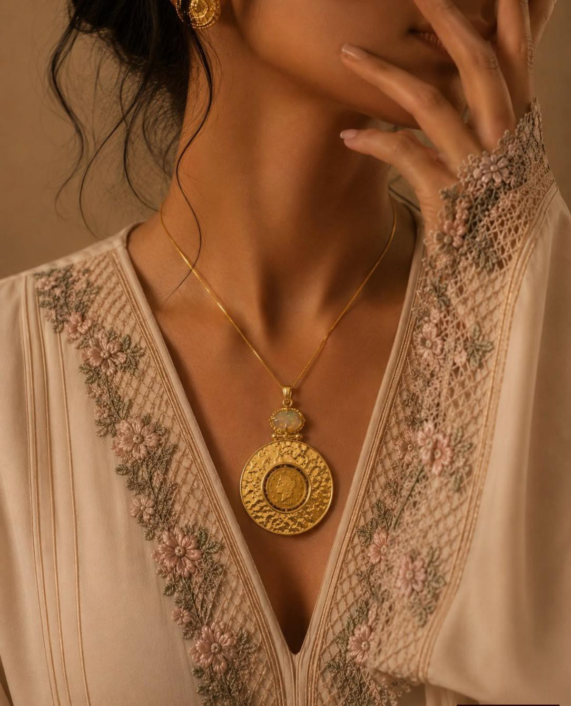

# Bashar Altaie Jewellery

[](https://github.com/abdullaalsabti/bashar-altaie-jewelry-sample/actions/workflows/ci.yml)
[](LICENSE)

An open-source, bilingual (English / Arabic) React + TypeScript marketing site for a Baghdad goldsmith. It features full RTL support, accessible components, responsive layouts and animation-led storytelling. It is a sample project and can be used as a starting point for a similar website.



## Features

- Single-page site: hero, collection, worn gallery, craft, stones, atelier and visit sections
- Product detail panel (modal dialog)
- English / Arabic switcher with persisted choice and automatic RTL layout
- Scroll-driven animations with `motion`, honouring `prefers-reduced-motion`
- Skip link, focus trapping in overlays, ARIA labels, keyboard navigation

## Tech stack

React 19 · TypeScript · Vite 6 · Tailwind CSS 4 · i18next / react-i18next · motion · Vitest + React Testing Library

## Localization and RTL

Translations live in [`src/i18n/en.json`](src/i18n/en.json) and [`src/i18n/ar.json`](src/i18n/ar.json). The language is chosen from `localStorage`, then the browser language. Switching sets `<html lang>` and `<html dir>`, and the layout uses logical CSS properties. Arabic swaps the font stack (see Design system below).

## Getting started

Requires Node.js 20+ (LTS).

```bash
npm ci            # or: npm install
npm run dev       # start the dev server
```

| Command | Purpose |
| --- | --- |
| `npm run build` | Type-check and build to `dist/` |
| `npm run typecheck` | TypeScript checks only |
| `npm test` | Run the Vitest suite once |
| `npm run test:watch` | Tests in watch mode |
| `npm run preview` | Preview the production build |

## Project structure

```
src/
  components/   Page sections and UI primitives
  hooks/        useDialog, useActiveSection, useAnchorScroll
  i18n/         i18next setup and en/ar translations
  test/         Test setup and tests
public/         Static assets (images, favicons, manifest)
.github/        CI workflow, issue and PR templates
```

## Screenshots

| | |
| --- | --- |
|  |  |
|  |  |

## Accessibility and responsive design

- Semantic landmarks (`header`, `nav`, `main`, `footer`), skip link, `aria-current` on active navigation
- Overlays trap focus, close on Escape and return focus to the opener
- Reduced-motion preferences respected in CSS, scrolling and animations
- Mobile-first layout with a dedicated full-screen mobile menu

## Contributions welcome

Contributions are welcome. Read [CONTRIBUTING.md](CONTRIBUTING.md), follow the [Code of Conduct](CODE_OF_CONDUCT.md), and open a [bug report or feature request](https://github.com/abdullaalsabti/bashar-altaie-jewelry-sample/issues/new/choose).

## Roadmap

See [ROADMAP.md](ROADMAP.md).

## License

[MIT](LICENSE) © 2026 Abdulla Al-Sabti. Product photography and branding are sample content for the demo.

## Deploy (Vercel)

Import the repo; `vercel.json` sets the Vite preset. Build command `npm run build`, output `dist`. No env vars.

## Design system

| Token | Value | Use |
| --- | --- | --- |
| `--color-ink` | `#0b0b0b` | Text, dark sections |
| `--color-paper` | `#ffffff` | Default surface |
| `--color-bone` | `#f5f2ec` | Alternate surface |
| `--color-champagne` | `#c2a87c` | Accent rules, marks — sampled from the gold in the product photography |
| `--color-champagne-deep` | `#9c8253` | Accent text (holds contrast on paper) |
| `--color-hairline` | `#e4dfd6` | Dividers |

Type: **Marcellus** (display — Roman inscriptional letterforms, chosen for the engraving connection) + **Jost** (body) + **IBM Plex Mono** (hallmark labels). Arabic swaps the whole stack to **Amiri** + **IBM Plex Sans Arabic** via `:root[dir='rtl']`, with looser leading so Amiri's ascenders and diacritics are not clipped.

Recurring device: a single champagne hairline that draws itself — as the scroll-progress rule under the nav, as the vertical spine in the Craft section, and as the short rule beside every section eyebrow. Spec labels are set as hallmarks (`18K · TURQUOISE · 9.2G`), the way they are stamped on the underside of a piece.

## Structure

```
src/
  App.tsx                 remounts on locale change so entrance animations replay
  i18n/                   i18next setup + en.json / ar.json; writes dir + lang to <html>
  components/
    primitives.tsx        Reveal, MaskedLines, Hallmark, DrawnRule
    Nav, Hero, Marquee, Collection, ProductModal, Craft, Stones, Atelier, Visit, Footer
```

Product copy and specs live entirely in the locale files; `PRODUCTS` in `Collection.tsx` maps a key to its image.

## Notes

- Contact form is client-side only — it shows a confirmation and resets. Wire it to a Vercel function or form service before real use.
- Prices read "On request"; no commerce layer.
- Reduced motion is respected globally, focus is visible on every control, and the layout holds from 390px up.
